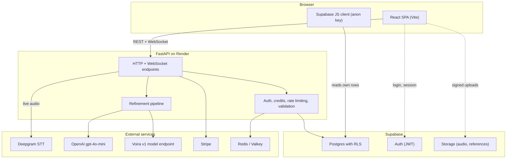
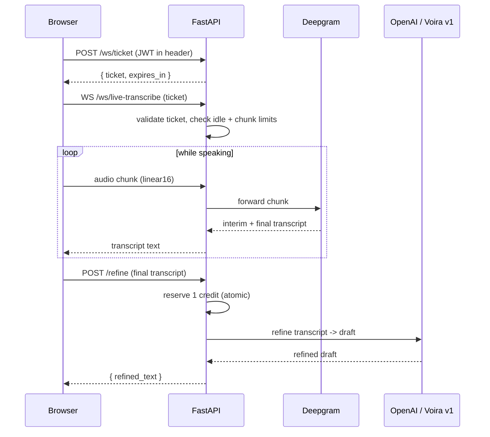
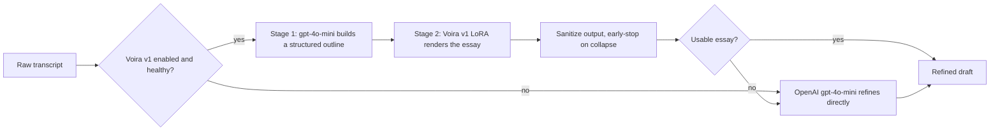
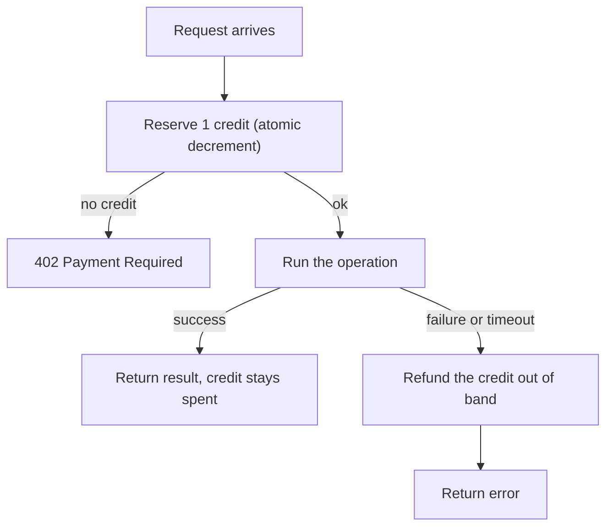

Author: Olaoluwa David James-Owolabi

# Voira

I started the Voira project in the winter of 2025. And since then, it has been a bliss of building and seeing how far this project has come and the impact it has made. In simple words, Voira is a voice-first writing coach. A user speaks a response to a prompt, the system transcribes the audio in real time, and it refines that spoken draft into written prose that preserves the speaker's wording and tone. The stack covers authentication, billing, live audio streaming, a fine-tuned language model, an admin console, and the free-tier infrastructure that keeps those pieces running.

The differentiator is the model path, not the transcription alone. Essay-style sessions run through a LoRA fine-tune trained to adapt across the kinds of writing users bring to the product. That pipeline is described under [The refinement pipeline](#the-refinement-pipeline).

This README covers system architecture, the decisions behind it, and the trade-offs those decisions carry.


Live app: [heyvoira.com](https://heyvoira.com) · API: [voira-api.onrender.com](https://voira-api.onrender.com)

## What it does

The user picks a mode (application essay, interview question, free-form topic, or practice), records a spoken answer, and watches the transcript stream in while speaking. When recording stops, Voira refines the transcript into a draft and shows an analysis beside it: filler-word count, pacing, a strongest-moment highlight, and a before/after view. A voice profile of preferred and avoided words feeds into refinement. Saved work lands in a per-user library.

The product is built around the gap between spoken clarity and written blank-page friction: capture the spoken version, then translate it into text without replacing the speaker's ideas.

## How the pieces fit together

The system is a React SPA talking to a FastAPI backend. Supabase holds identity and data. Specialized work goes to Deepgram (speech-to-text), OpenAI (language work), Stripe (payments), and an optional Voira v1 model endpoint.



The browser talks to Supabase for two things only: login and reading the user's own rows. Anything that spends money or grants an entitlement goes through the FastAPI backend. That split is the security model.

The backend is stateless. It rebuilds request context from a JWT and the database, so it can run as multiple Gunicorn workers on Render or as multiple Kubernetes replicas without sticky sessions.

## The path of one live session

Live transcription spans REST, WebSockets, and a third-party stream. Browsers cannot attach an `Authorization` header to a WebSocket, so the client first authenticates over HTTP to get a short-lived ticket, then opens the socket with that ticket.



The ticket expires after `ws_ticket_ttl_seconds` (60 seconds by default). The socket enforces an idle timeout (`ws_idle_timeout`, 5 minutes), and each inbound chunk is size-capped. Abandoned connections cannot sit open forever, and a client cannot stream unbounded audio into a free-tier box.

## The refinement pipeline

Essay-style refinement is a two-stage pipeline. Stage two is a fine-tuned Voira v1 LoRA adapter rather than a generic transcription-to-chatbot handoff.



Stage one asks `gpt-4o-mini` to turn the spoken transcript into a structured outline. Stage two feeds that outline to Voira v1, a LoRA adapter (`ekomobng/voira-essay-lora-v1`) on Llama 3.1 8B Instruct, which renders the outline into a finished essay.

In development the model runs as a separate local server using `mlx-lm`, fused and quantized to 4-bit so the 8B model fits in about 6 GB of RAM on Apple Silicon. It serves one generation at a time (an 8B model on a laptop cannot handle concurrent requests without thrashing) and runs blocking generation off the event loop so health checks still answer. In production the backend points `VOIRA_MODEL_URL` at a hosted endpoint (Hugging Face Inference Endpoints or Replicate); the client path does not change.

Two reliability details matter more than the model itself:

The backend health-probes the inference endpoint before it spends money on the stage-one OpenAI call. Without that probe, an unreachable model would still bill the outline step, fail at stage two, and fall back, paying OpenAI twice for one request.

The model was trained on a small dataset, so it can start echoing outline scaffolding once it runs out of learned content. The server watches the running output, stops on that collapse signature, trims to the last clean sentence, and returns what is usable. If the result is too short to be a real essay, the request falls back to the direct OpenAI path. The feature flag `VOIRA_MODEL_ENABLED` can disable the model with no code change.

## Data model

Ten tables in the public schema, all with Row Level Security enabled. Migrations live in `supabase/migrations/` and are applied through Supabase.

| Table | What it holds | Who can write |
| --- | --- | --- |
| `user_profiles` | Role, credits remaining, monthly allowance, reset time, disabled flag | Backend |
| `recordings` | Saved sessions and transcripts | Owner |
| `drafts` | Refined drafts | Owner |
| `essays` | Essay content | Owner |
| `voice_profiles` | Preferred and avoided words, style notes | Owner |
| `user_settings` | Per-user preferences | Owner |
| `credits_ledger` | Append-only credit history | Backend only |
| `admin_emails` | Privileged emails | Backend only, no client read |
| `admin_audit_log` | Immutable record of admin actions with IP and user agent | Backend only |
| `stripe_webhook_events` | Idempotency claims for Stripe events | Backend only |

Anything tied to money or privilege (`credits_ledger`, `admin_emails`, `stripe_webhook_events`) is unreachable from the browser even with a valid login. RLS lets a user read their own `recordings` and `drafts`, and nothing else.

## How security is enforced

The frontend ships with the Supabase anon key, which is public by design. The backend holds the service role key and is the only component that can act across users. Authorization decisions live on the server.

Admin status is the clearest example. The browser never queries `admin_emails`. It calls `GET /admin/is-admin`, which returns `{ "isAdmin": true }` or `{ "isAdmin": false }` and nothing else. The admin list never leaves the server.

RLS is a backstop. The backend makes the real authorization decision, and the database policies catch anything that slips past it. If a query arrives without a valid auth context, Postgres returns an empty result instead of an error, so the backend treats empty data as a failure to prove ownership rather than as "no rows." Access is denied by default and allowed only where a policy explicitly grants it.

WebSocket auth uses the ticket flow above, so no long-lived JWT sits in a URL or a log. Errors sent to clients are generic ("Transcription stream error") while full detail goes to logs and Sentry. The frontend is served with HSTS, `X-Frame-Options: DENY`, `X-Content-Type-Options: nosniff`, and a `Permissions-Policy` that allows the microphone and nothing else (`apps/web/vercel.json`).

## Keeping it reliable on a budget

Since Voira is still in its early stages, most of my operational work is about surviving free and near-free tiers, although I also bear in mind the better application of system design concepts, which would obviously take more cost and scale.

Credits are reserved, then refunded on failure. An operation that costs a credit decrements atomically up front, which closes the race where two concurrent requests both see one credit left and both proceed. On failure, timeout, or `asyncio.CancelledError` (client disconnect), the credit is refunded out of band. Users are not charged for failures and cannot double-spend by clicking twice.



Rate limiting is Redis-backed and keyed per user. An in-memory limiter does not share state across Gunicorn workers, so the effective limit becomes the configured number times the worker count. Redis (Render Key Value, which is Valkey) makes the limit mean what it says across workers and replicas. Production refuses to start without `REDIS_URL`; development falls back to in-memory with a warning.

Stripe webhooks are idempotent. The handler claims each event id in `stripe_webhook_events` before doing work and skips anything already claimed. Retried deliveries are no-ops, with a full audit trail of what was processed.

Timeouts are explicit and aligned. The OpenAI client has a per-attempt timeout and bounded retries; endpoint timeouts in middleware match, so a hung upstream surfaces as a clean error and a refund rather than a worker tied up until the platform kills it.

Supabase pauses a free project after about a week of no database activity. A scheduled GitHub Action runs a tiny read-only query a few times a day so the project registers activity and stays up.

`GET /health` is a liveness check that answers if the process is up. `GET /health/ready` verifies dependencies and returns 503 when something critical is down; Kubernetes and the Docker `HEALTHCHECK` use that to decide whether to send traffic. Errors report to Sentry with environment-specific sampling.

## API reference

Base URL in production is `https://voira-api.onrender.com`. Every endpoint except the health and version checks requires a Supabase JWT in the `Authorization: Bearer <token>` header. Credit-consuming endpoints return `402` when credits are exhausted.

| Method | Path | Purpose |
| --- | --- | --- |
| GET | `/health`, `/health/ready` | Liveness and readiness |
| GET | `/api/versions` | Supported API versions |
| GET | `/auth/me` | Current user, role, and credits |
| GET | `/admin/is-admin` | Returns `{ isAdmin }` only |
| POST | `/ws/ticket` | Short-lived WebSocket ticket |
| WS | `/ws/live-transcribe` | Live audio to transcript stream |
| POST, GET, PUT, DELETE | `/sessions` | Session (recording) CRUD |
| POST, GET, PUT, DELETE | `/drafts` | Draft CRUD |
| POST | `/transcribe` | Batch transcription of an uploaded file |
| POST | `/refine`, `/analyze`, `/refine-interview` | Refinement and analysis (1 credit) |
| POST | `/upload-audio`, `/upload-reference` | Signed uploads to Storage |
| GET, PUT | `/user/settings` | Per-user settings |
| GET | `/user/export`, `/sessions/{id}/export` | Data export |
| POST | `/billing/create-checkout-session` | Start a Stripe subscription |
| POST | `/billing/create-portal-session` | Open the Stripe billing portal |
| GET | `/billing/subscription-status` | Current subscription state |
| POST | `/webhooks/stripe` | Stripe webhook receiver |
| GET, POST | `/admin/*` | Admin console (users, credits, audit log, analytics) |

Representative calls:

```bash
curl https://voira-api.onrender.com/auth/me \
  -H "Authorization: Bearer $JWT"
```

```json
{
  "id": "0b1c...",
  "email": "you@example.com",
  "role": "free_user",
  "credits_remaining": 9,
  "monthly_credit_allowance": 10,
  "credits_reset_at": "2026-12-01T00:00:00Z"
}
```

```bash
curl -X POST https://voira-api.onrender.com/ws/ticket \
  -H "Authorization: Bearer $JWT"
# { "ticket": "v1:...", "expires_in": 60 }
```

```bash
curl -X POST https://voira-api.onrender.com/refine \
  -H "Authorization: Bearer $JWT" \
  -H "Content-Type: application/json" \
  -d '{
    "raw_transcript": "um so basically the project i am most proud of is...",
    "session_type": "application",
    "question": "Describe a project you are proud of.",
    "word_limit": 300
  }'
# { "refined_text": "The project I am proudest of ..." }
```

```bash
curl -X POST https://voira-api.onrender.com/billing/create-checkout-session \
  -H "Authorization: Bearer $JWT" \
  -H "Content-Type: application/json" \
  -d '{
    "price_id": "price_123",
    "success_url": "https://heyvoira.com/billing/success",
    "cancel_url": "https://heyvoira.com/pricing"
  }'
# { "checkout_url": "https://checkout.stripe.com/...", "session_id": "cs_..." }
```

## Decisions and trade-offs

What would be a talk about the core design architecture of Voira without talking about some difficult decisions and trade-offs I had to make? Each of these is a fork where a different choice would have produced a different system.

### Supabase instead of raw cloud instances

The alternative is a Postgres instance, a separate auth service, object storage, and the networking between them. Supabase bundles Postgres, auth, storage, and row-level security in one project.

The win is managed Postgres, JWT auth with refresh handling, signed storage uploads, and a policy engine without operating those pieces separately. RLS pushes an authorization boundary into the database instead of trusting application code alone.

The cost is coupling to Supabase's auth model and platform behavior, including the free-tier pause that required the keep-alive job. Migrations are applied through Supabase rather than by a runner inside the backend, which is a manual gated step that must stay in sync with the repo. Leaving Supabase later would hurt most on the auth integration. At the current stage, one platform instead of four services is the better trade, and the RLS boundary outweighs provider independence.

### Render and Vercel on their free tiers

The backend runs on Render, the frontend on Vercel, both free. Static files on a CDN fit a free plan well. The backend trade-offs are more visible: a free Render service sleeps after inactivity and cold-starts on the next request, and the free Key Value store has no persistence, so rate-limit windows reset on restart. A reset rate-limit window is harmless, and the cold start is a few seconds on a product that is not yet latency-critical. The fix for either is a paid instance, not a rewrite.

### A monorepo with npm workspaces

Frontend and backend live in one repository under `apps/`. One clone, one CI pipeline, and stack-spanning changes land in one place. The cost is that the npm and Python toolchains share a root, and the backend tests live at the repo root `tests/` rather than under `apps/api/`. For a single maintainer, the coordination savings outweigh that awkwardness.

### Deepgram streaming instead of batch transcription

Transcription could wait for the full recording and send one request. Instead, audio streams to Deepgram over a socket and interim results appear while the user speaks. Live feedback is the product's feel; the ticket flow, idle and chunk limits, and backpressure are the cost of that feel.

### Reserve-then-refund billing instead of charge-on-success

The simpler design charges a credit when an operation succeeds. That leaves a race: two requests both read the last credit and both proceed. Reserving the credit up front with an atomic decrement closes the race, at the cost of a refund path for every failure mode, including client disconnects. Billing integrity under concurrency is worth the extra code.

### WebSocket tickets instead of a JWT in the URL

Putting the JWT in the query string is the quick path, but URLs get logged in many places. A short-lived single-purpose ticket issued over HTTP means no durable credential ends up in a log.

### A self-hosted fine-tune with a managed fallback

The system uses both: Voira v1 so drafts adapt to the different kinds of writing users bring, and a direct OpenAI path as a fallback the feature flag can promote to primary instantly. That means two inference paths to maintain and a model to train and host. In exchange, specialized output is available when the model is healthy, and the product keeps working when it is not, which matters when the model is an 8B running on constrained hardware.

## Containers and local Kubernetes

The repo ships a working local stack in Docker and Kubernetes manifests for kind or minikube. These are for operational practice and local validation; production still deploys on Render and Vercel.

### Docker Compose

```bash
docker compose up --build
# web  -> http://localhost:8080
# api  -> http://localhost:8000
# redis (valkey) on :6379
```

Compose runs three services: the FastAPI backend (`infra/Dockerfile`), the web app behind nginx (`apps/web/Dockerfile`), and Valkey so the rate limiter uses its real backend instead of the in-memory fallback. Supabase stays in the cloud; point the env files at the project. The Voira v1 inference server is not a Compose service, because `mlx` needs Apple Silicon and Metal, which Docker on macOS does not expose. Run it on the host and point `VOIRA_MODEL_URL` at `http://host.docker.internal:8090`; left unset, the backend uses the OpenAI fallback path.

Copy `apps/api/.env.example` and `apps/web/.env.example` to `.env` files and fill them in before bringing the stack up. The Environment variables section below describes the split.

### Kubernetes on kind

The manifests in `infra/k8s/` bring up the same three services with health probes, resource limits, and an ingress. A `kustomization.yaml` installs the core set and never touches the template secret or the optional autoscaler.

```bash
kind create cluster --name voira

# Build the images and load them into the cluster (kind does not see
# local Docker images by default).
docker build -t voira-api:local -f infra/Dockerfile .
docker build -t voira-web:local \
  --build-arg VITE_API_BASE_URL=http://api.voira.local \
  --build-arg VITE_SUPABASE_URL=https://your-project.supabase.co \
  --build-arg VITE_SUPABASE_ANON_KEY=your-anon-key \
  -f apps/web/Dockerfile .
kind load docker-image voira-api:local voira-web:local --name voira

# Create the real secret from the template, then apply the core set.
cp infra/k8s/secret.example.yaml infra/k8s/secret.yaml   # then edit it
kubectl apply -k infra/k8s/
kubectl -n voira get pods
```

The images are built from the same Dockerfiles Compose uses. Liveness hits `/health`, readiness hits `/health/ready`, so a pod only receives traffic once its dependencies answer. The web API URL is baked in at build time, so build the web image with `VITE_API_BASE_URL` set to the API ingress host. On a local cluster refinement uses the OpenAI fallback path, since the `mlx` model cannot run in a Linux container. The optional autoscaler is a separate apply (`kubectl apply -f infra/k8s/hpa.yaml`) because it needs metrics-server.

### Next infrastructure experiments

Free-tier experiments that teach the most without costing anything:

- Publish images to GHCR from CI so Kubernetes manifests pull a tagged image instead of a local build. A skeleton workflow for this is included below.
- Add Prometheus and Grafana to the local cluster to scrape the backend and chart request rate, latency, and error rate.
- Turn on a HorizontalPodAutoscaler against the API deployment and generate load to watch it scale (safe because the backend is stateless).
- Run the Supabase CLI local stack so the whole system, database included, comes up offline.
- For the model, a GPU node (or a CPU `llama.cpp` build of the same adapter) would let the inference server run inside the cluster. That path is documented rather than defaulted, because it needs hardware the free tier does not provide.

### Optional: build images in CI

`.github/workflows/docker-build.yml` builds the API and web images and pushes them to GHCR on a push to `main`. It is off the critical path; the app deploys fine without it. It exists so a Kubernetes workflow can consume versioned images.

## Project layout

```
apps/
  web/            React SPA (Vite, react-router v7, Radix/shadcn, Tailwind)
  api/            FastAPI backend (auth, transcription, refinement, billing, admin)
    inference_server.py   Local mlx server for Voira v1 (dev only)
    voira_model.py        Client for the hosted Voira v1 endpoint
supabase/         SQL migrations and RLS policies
infra/
  Dockerfile      Backend image
  k8s/            Kubernetes manifests for local clusters
docs/
  architecture/   Audits, architecture notes, analytics writeups
  history/        Implementation log, migration notes, phase plans
  llm/            Refinement and prompt-caching notes
  ops/            Production setup notes
tests/            Backend pytest suite (at the repo root, by design)
docker-compose.yml
SECURITY.md       Security policy (kept at repo root for GitHub)
```

## Environment variables

Most of the environment variables are confidential, so I am choosing to leave it out of this readme.
