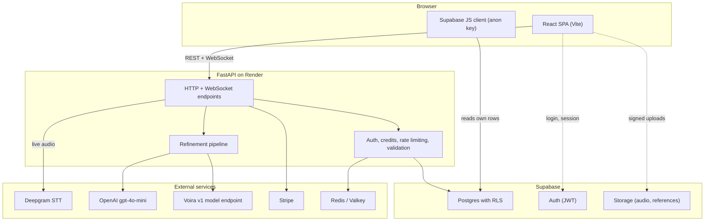
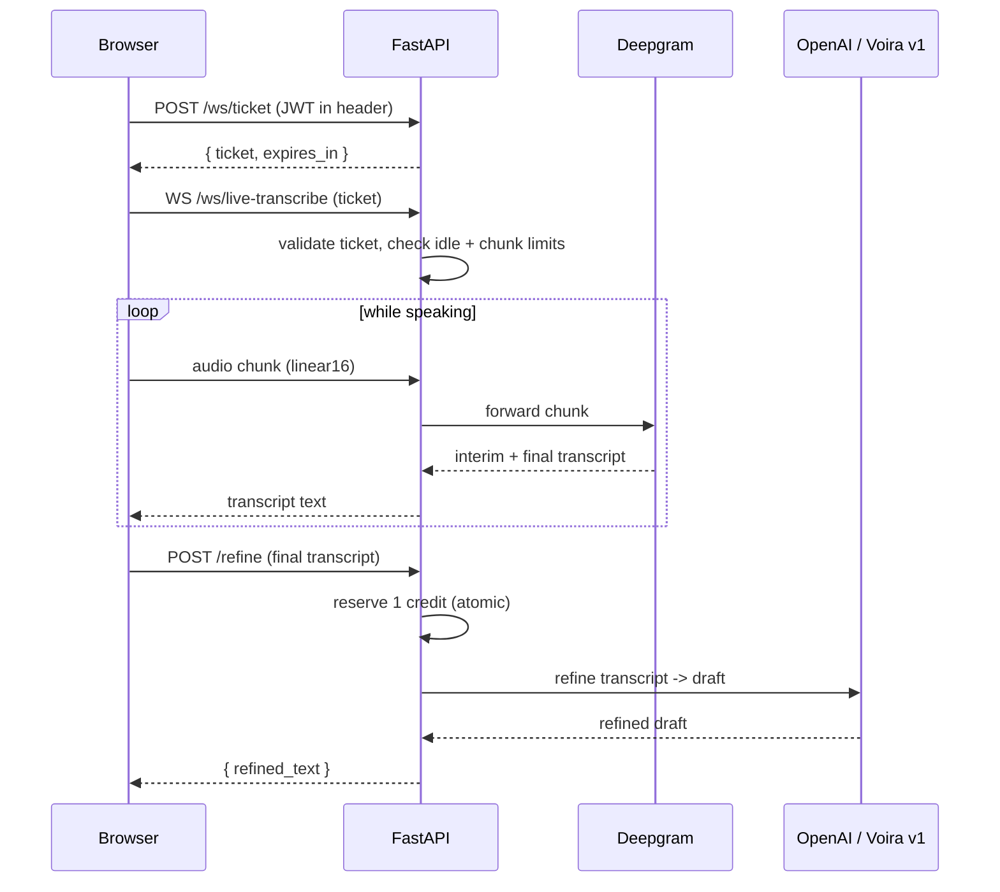
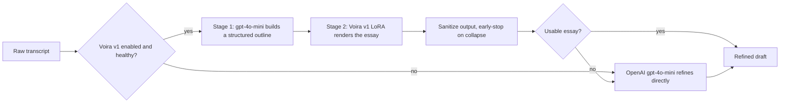
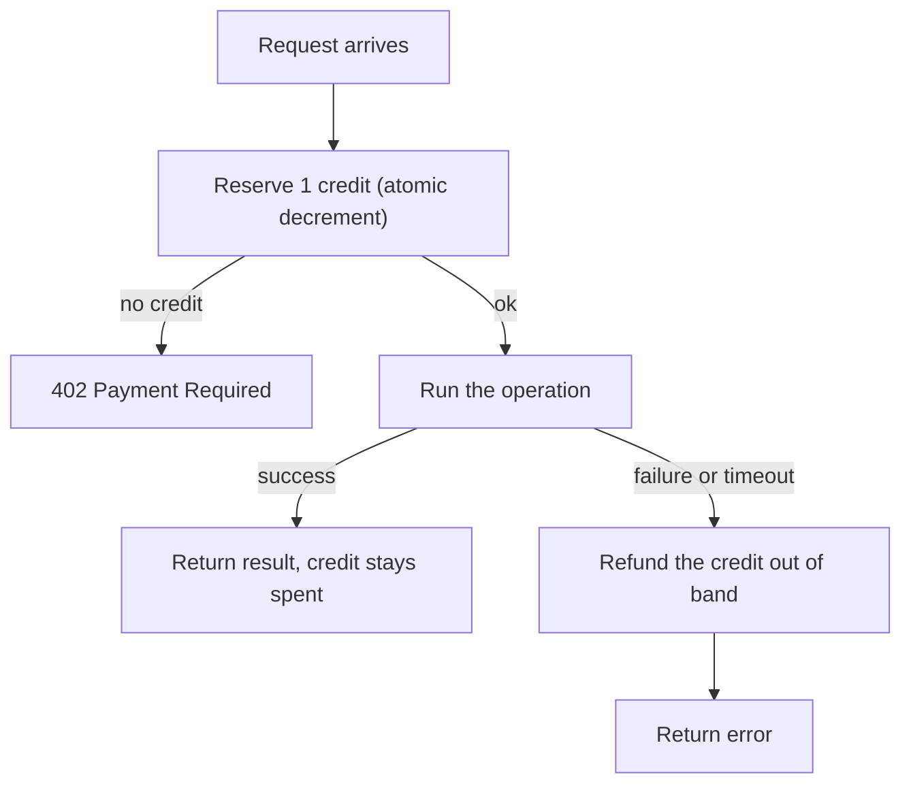

# Voira

Voira is a voice-first writing coach. A user speaks their response to a prompt, Voira transcribes the audio in real time, and it refines that spoken draft into clean written prose that keeps the speaker's own wording. The system is a complete product: authentication, billing, live audio streaming, a fine-tuned language model, an admin console, and the infrastructure that keeps all of it running on free-tier services.

Generative AI has made it easy to hand writing off entirely, and a lot of people, students especially, are losing the habit of working their own ideas into shape on the page. Voira is built around the opposite premise: you talk through what you actually think, and it helps you turn that into your own writing instead of something a model made up for you. What sets it apart from tools that bolt speech-to-text onto a chatbot is the core model and the way it was trained, a LoRA fine-tune aimed at adapting to the different kinds of writing people bring to it. That training is covered in the architecture section below.

This README is the long version. It covers how the system is put together, the decisions I made, and the ones I deliberately avoided. Where a choice carried a real cost, I have tried to say so rather than pretend there was an obvious right answer.


Live app: [heyvoira.com](https://heyvoira.com) · API: [voira-api.onrender.com](https://voira-api.onrender.com)

## What it does

You pick a mode (an application essay, an interview question, a free-form topic, or a practice run), record yourself talking it through, and watch the transcript stream in as you speak. When you stop, Voira refines the transcript into a draft and shows you an analysis next to it: filler-word count, pacing, a "strongest moment" highlight, and a before/after view. You can keep a voice profile of words you like and words you want to avoid, and the refinement honors it. Everything you save lands in a per-user library.

The point of the product is the gap between how people talk and how they write. Plenty of people explain an idea clearly out loud and then freeze at a blank page. Voira records the clear spoken version and does the translation.

## How the pieces fit together

The system is a React app talking to a FastAPI backend, with Supabase holding identity and data, and three external services doing the specialized work: Deepgram for speech-to-text, OpenAI for language work, and Stripe for payments.



A few things are worth saying about why the boxes are drawn this way.

The browser talks to Supabase directly for two things only: logging in and reading the user's own rows. Every operation that costs money or grants an entitlement goes through the FastAPI backend instead. That split is the backbone of the security model, and I come back to it below.

The backend is stateless. It holds no session in memory that it cannot rebuild from a JWT and the database, which is what lets it run as multiple Gunicorn workers behind Render and, later, as several replicas in Kubernetes without sticky sessions.

## The path of one live session

Live transcription is the most interesting request in the system because it spans REST, WebSockets, and a third-party stream at once. Browsers cannot attach an `Authorization` header to a WebSocket, so I use a short-lived ticket: the client authenticates over normal HTTP to get a ticket, then opens the socket with it.



The ticket carries its own expiry (`ws_ticket_ttl_seconds`, 60 seconds by default), the socket enforces an idle timeout (`ws_idle_timeout`, 5 minutes), and each inbound chunk is size-capped. A dropped or abandoned connection cannot sit open forever, and a client cannot stream unbounded audio into a free-tier box.

## The refinement pipeline

I wanted Voira to be more than a generic transcription wrapper, so a lot of the work went into the user experience and the product thinking, not just the model. For essay-style sessions refinement runs a two-stage pipeline, and the second stage is my own fine-tuned model.



Stage one asks `gpt-4o-mini` to turn the spoken transcript into a structured outline. Stage two feeds that outline to Voira v1, a LoRA adapter (`ekomobng/voira-essay-lora-v1`) I trained on top of Llama 3.1 8B Instruct, which renders the outline into a finished essay.

In development the model runs as a separate local server using `mlx-lm`, fused and quantized to 4-bit so the 8B model fits in about 6 GB of RAM on an Apple Silicon Mac. It serves one generation at a time, because an 8B model on a laptop cannot handle concurrent requests without thrashing, and it runs the blocking generation off the event loop so health checks still answer while it works. In production the backend points `VOIRA_MODEL_URL` at a hosted endpoint (Hugging Face Inference Endpoints or Replicate) instead, and nothing else changes.

Two reliability details matter more than the model itself:

The backend health-probes the inference endpoint before it spends money on the stage-one OpenAI call. Without that probe, an unreachable model would still run (and bill) the outline step, then fail at stage two and fall back, paying OpenAI twice for one request. The probe makes the common failure cheap.

The model was trained on a small dataset, so it sometimes starts echoing its outline scaffolding back out as filler once it runs out of learned content. The server watches the running output and stops the moment it sees that collapse signature, trims back to the last clean sentence, and hands back what is usable. If what remains is too short to be a real essay, the whole thing falls back to the direct OpenAI path. The feature flag (`VOIRA_MODEL_ENABLED`) can turn the model off entirely with no code change, and the user never sees a difference beyond the wording of the draft.

## Data model

Ten tables in the public schema, all with Row Level Security enabled. Migrations live in `supabase/migrations/` and are applied through Supabase.

| Table | What it holds | Who can write |
| --- | --- | --- |
| `user_profiles` | Role, credits remaining, monthly allowance, reset time, disabled flag | Backend |
| `recordings` | Saved sessions and transcripts | Owner |
| `drafts` | Refined drafts | Owner |
| `essays` | Essay content | Owner |
| `voice_profiles` | Preferred and avoided words, style notes | Owner |
| `user_settings` | Per-user preferences | Owner |
| `credits_ledger` | Append-only credit history | Backend only |
| `admin_emails` | Privileged emails | Backend only, no client read |
| `admin_audit_log` | Immutable record of admin actions with IP and user agent | Backend only |
| `stripe_webhook_events` | Idempotency claims for Stripe events | Backend only |

The split in the "who can write" column is deliberate. Anything tied to money or privilege (`credits_ledger`, `admin_emails`, `stripe_webhook_events`) is unreachable from the browser even with a valid login. RLS lets a user read their own `recordings` and `drafts`, and nothing else.

## How security is enforced

The frontend ships with the Supabase anon key, which is public by design. The backend holds the service role key and is the only thing that can act across users. Every real authorization decision lives on the server.

The clearest example is admin status. The browser never queries `admin_emails`. It calls `GET /admin/is-admin`, which returns `{ "isAdmin": true }` or `{ "isAdmin": false }` and nothing else. The admin list never leaves the server, so a user poking at the network tab learns only their own answer.

RLS is a backstop. The backend makes the real authorization decision, and the database policies are there to catch anything that slips past it. If a query arrives without a valid auth context, Postgres returns an empty result instead of an error, so the backend treats empty data as a failure to prove ownership rather than as "no rows." Access is denied by default and allowed only where a policy explicitly grants it.

WebSocket auth uses the ticket flow described above, so no long-lived JWT ever sits in a URL or a log. Errors sent to clients are generic ("Transcription stream error") while the full detail goes to the logs and Sentry, so a stack trace never travels to the browser. The frontend is served with a strict set of headers (HSTS, `X-Frame-Options: DENY`, `X-Content-Type-Options: nosniff`, and a `Permissions-Policy` that allows the microphone and nothing else), defined in `apps/web/vercel.json`.

## Keeping it reliable on a budget

Most of the operational work went into surviving on free and near-free tiers without lying to users about what happened.

Credits are reserved, then refunded on failure. When you start an operation that costs a credit, the backend decrements atomically up front, which closes the race where two concurrent requests both see "one credit left" and both proceed. If the operation then fails or times out, the credit is refunded out of band, including on `asyncio.CancelledError` when a client disconnects mid-request. You are never charged for a failure, and you cannot double-spend by clicking twice.



Rate limiting is Redis-backed and keyed per user. The in-memory limiter I started with did not share state across Gunicorn workers, so a user's real limit was the configured number times the worker count. Moving to Redis (Render's free Key Value, which is Valkey) made the limit mean what it says regardless of how many workers or replicas are running. Production refuses to start without `REDIS_URL`; development falls back to in-memory with a warning.

Stripe webhooks are idempotent. Stripe retries, so the handler claims each event id in `stripe_webhook_events` before doing any work and skips anything already claimed. A retried delivery is a no-op, and there is a full audit trail of what was processed.

Timeouts are explicit and aligned. The OpenAI client has a per-attempt timeout and bounded retries, and the endpoint timeouts in the middleware match, so a hung upstream surfaces as a clean error and a refund rather than a worker tied up until the platform kills it.

The database is kept awake deliberately. Supabase pauses a free project after about a week of no database activity, which is what first took the app down. A scheduled GitHub Action now runs a tiny read-only query a few times a day so the project registers real activity and stays up. It is the cheapest possible fix, it lives in the repo, and it costs nothing.

Health checks exist for probes. `GET /health` is a liveness check that always answers if the process is up; `GET /health/ready` verifies dependencies and returns 503 when something critical is down, which is what Kubernetes and the Docker `HEALTHCHECK` use to decide whether to send traffic. Errors across the app report to Sentry with environment-specific sampling.

## API reference

Base URL in production is `https://voira-api.onrender.com`. Every endpoint except the health and version checks requires a Supabase JWT in the `Authorization: Bearer <token>` header. Credit-consuming endpoints return `402` when you are out of credits.

| Method | Path | Purpose |
| --- | --- | --- |
| GET | `/health`, `/health/ready` | Liveness and readiness |
| GET | `/api/versions` | Supported API versions |
| GET | `/auth/me` | Current user, role, and credits |
| GET | `/admin/is-admin` | Returns `{ isAdmin }` only |
| POST | `/ws/ticket` | Short-lived WebSocket ticket |
| WS | `/ws/live-transcribe` | Live audio to transcript stream |
| POST, GET, PUT, DELETE | `/sessions` | Session (recording) CRUD |
| POST, GET, PUT, DELETE | `/drafts` | Draft CRUD |
| POST | `/transcribe` | Batch transcription of an uploaded file |
| POST | `/refine`, `/analyze`, `/refine-interview` | Refinement and analysis (1 credit) |
| POST | `/upload-audio`, `/upload-reference` | Signed uploads to Storage |
| GET, PUT | `/user/settings` | Per-user settings |
| GET | `/user/export`, `/sessions/{id}/export` | Data export |
| POST | `/billing/create-checkout-session` | Start a Stripe subscription |
| POST | `/billing/create-portal-session` | Open the Stripe billing portal |
| GET | `/billing/subscription-status` | Current subscription state |
| POST | `/webhooks/stripe` | Stripe webhook receiver |
| GET, POST | `/admin/*` | Admin console (users, credits, audit log, analytics) |

A few representative calls follow.

Current user and credit balance:

```bash
curl https://voira-api.onrender.com/auth/me \
  -H "Authorization: Bearer $JWT"
```

```json
{
  "id": "0b1c...",
  "email": "you@example.com",
  "role": "free_user",
  "credits_remaining": 9,
  "monthly_credit_allowance": 10,
  "credits_reset_at": "2026-12-01T00:00:00Z"
}
```

Get a WebSocket ticket, then connect:

```bash
curl -X POST https://voira-api.onrender.com/ws/ticket \
  -H "Authorization: Bearer $JWT"
# { "ticket": "v1:...", "expires_in": 60 }
```

Refine a transcript into a draft (costs one credit):

```bash
curl -X POST https://voira-api.onrender.com/refine \
  -H "Authorization: Bearer $JWT" \
  -H "Content-Type: application/json" \
  -d '{
    "raw_transcript": "um so basically the project i am most proud of is...",
    "session_type": "application",
    "question": "Describe a project you are proud of.",
    "word_limit": 300
  }'
# { "refined_text": "The project I am proudest of ..." }
```

Start a subscription checkout:

```bash
curl -X POST https://voira-api.onrender.com/billing/create-checkout-session \
  -H "Authorization: Bearer $JWT" \
  -H "Content-Type: application/json" \
  -d '{
    "price_id": "price_123",
    "success_url": "https://heyvoira.com/billing/success",
    "cancel_url": "https://heyvoira.com/pricing"
  }'
# { "checkout_url": "https://checkout.stripe.com/...", "session_id": "cs_..." }
```

## Decisions and trade-offs

This is the part I actually care about. Each of these was a fork where a different choice would have produced a different system.

### Supabase instead of raw cloud instances

I could have stood up a Postgres instance, a container for an auth service, an object store, and the networking to connect them. I chose Supabase, which bundles Postgres, auth, storage, and row-level security behind one project.

The win is that a solo developer gets managed Postgres, JWT auth with refresh handling, signed storage uploads, and a policy engine without operating any of it. RLS in particular let me push a real authorization boundary down into the database instead of trusting application code alone.

The cost is honest. I am tied to Supabase's auth model and its platform behavior, including the free-tier pause that bit me and forced the keep-alive job. Migrations are applied through Supabase rather than by a runner inside the backend, which is a manual, gated step I have to keep in sync with the repo. If this ever needed to leave Supabase, the auth integration is the piece that would hurt. For the current stage, managing one platform instead of four services is the right trade, and the RLS boundary is worth more to me than provider independence.

### Render and Vercel on their free tiers

The backend runs on Render, the frontend on Vercel, both free. The frontend is static files on a CDN, which is a genuinely good fit for a free plan. The backend is where the trade-off shows: a free Render service sleeps after inactivity and cold-starts on the next request, and the free Key Value store has no persistence, so rate-limit windows reset when it restarts. I accepted both. A reset rate-limit window is harmless, and the cold start is a few seconds on a product that is not yet latency-critical. The moment either becomes a real problem, the fix is a paid instance, not a rewrite.

### A monorepo with npm workspaces

Frontend and backend live in one repository under `apps/`. One clone, one CI pipeline, and changes that span the stack land in one place. The cost is that the two toolchains (npm and Python) share a root, and a quirk I documented is that the backend tests live at the repo root `tests/` rather than under `apps/api/`. For a single maintainer, the coordination this saves is worth the small awkwardness.

### Deepgram streaming instead of batch transcription

Transcription could have waited for the full recording and sent one request. I stream audio to Deepgram over a socket and show interim results as the user speaks. Live feedback is most of the product's feel, so the extra moving parts (the ticket flow, idle and chunk limits, backpressure) are the cost of the thing that makes it feel alive.

### Reserve-then-refund billing instead of charge-on-success

The simpler design charges a credit when an operation succeeds. That leaves a race: two requests both read the last credit and both go. Reserving the credit up front with an atomic decrement closes the race, at the cost of a refund path I have to maintain for every failure mode, including client disconnects. Billing integrity under concurrency was worth the extra code.

### WebSocket tickets instead of a JWT in the URL

The quick way to authenticate a socket is to put the JWT in the query string. URLs get logged in a lot of places, so I issue a short-lived single-purpose ticket over HTTP and connect with that. More steps, but no durable credential ends up in a log.

### A self-hosted fine-tune with a managed fallback

I could have used OpenAI for everything, or committed fully to self-hosting. I did both: the fine-tuned Voira v1 so drafts adapt to the different kinds of writing users bring to it, with the direct OpenAI path as a fallback that the feature flag can promote to primary instantly. That means two inference paths to maintain and a model to train and host. In exchange I get the specialized output when the model is healthy and a product that keeps working when it is not, which matters a lot more when the model is an 8B running on constrained hardware.

## Running it locally

You need Node 18+, Python 3.11+, and a Supabase project.

```bash
npm install
npm run dev        # starts the API and the web app together
# or separately:
npm run dev:api    # FastAPI on :8000
npm run dev:web    # Vite on :5173
```

Backend tests live at the repo root, not under `apps/api/`:

```bash
cd apps/api && pytest ../../tests -v
```

Environment variables go in `apps/web/.env` and `apps/api/.env` (copy the committed `.env.example` files and fill them in); the Environment variables section at the end of this file explains how they are split.

## Containers and local Kubernetes

Voira is small, which makes it a good place to practice the operational side without risk. The repo ships a working local stack in Docker and a set of Kubernetes manifests you can run on a laptop with kind or minikube.

### Docker Compose

```bash
docker compose up --build
# web  -> http://localhost:8080
# api  -> http://localhost:8000
# redis (valkey) on :6379
```

Compose runs three services: the FastAPI backend (from `infra/Dockerfile`), the web app built and served by nginx (from `apps/web/Dockerfile`), and Valkey so the rate limiter uses its real backend instead of the in-memory fallback. Supabase stays in the cloud; point the env files at your project. The Voira v1 inference server is not a Compose service, because `mlx` needs Apple Silicon and Metal and Docker on macOS does not expose them. You run it on the host and point `VOIRA_MODEL_URL` at `http://host.docker.internal:8090`; left unset, the backend uses the OpenAI fallback path.

### Kubernetes on kind

The manifests in `infra/k8s/` bring up the same three services with health probes, resource limits, and an ingress. They are wired with a `kustomization.yaml` so a single apply installs the core set and never touches the template secret or the optional autoscaler.

```bash
kind create cluster --name voira

# Build the images and load them into the cluster (kind does not see your
# local Docker images by default).
docker build -t voira-api:local -f infra/Dockerfile .
docker build -t voira-web:local \
  --build-arg VITE_API_BASE_URL=http://api.voira.local \
  --build-arg VITE_SUPABASE_URL=https://your-project.supabase.co \
  --build-arg VITE_SUPABASE_ANON_KEY=your-anon-key \
  -f apps/web/Dockerfile .
kind load docker-image voira-api:local voira-web:local --name voira

# Create the real secret from the template, then apply the core set.
cp infra/k8s/secret.example.yaml infra/k8s/secret.yaml   # then edit it
kubectl apply -k infra/k8s/
kubectl -n voira get pods
```

The images are built from the same Dockerfiles Compose uses. Liveness hits `/health`, readiness hits `/health/ready`, so a pod only receives traffic once its dependencies answer. The web API URL is baked in at build time, so build the web image with `VITE_API_BASE_URL` set to the API ingress host. On a local cluster the refinement runs the OpenAI fallback path, since the `mlx` model cannot run in a Linux container. The optional autoscaler is a separate apply (`kubectl apply -f infra/k8s/hpa.yaml`) because it needs metrics-server.

### Where I would take the infrastructure next

These are the free-tier experiments that would teach the most without costing anything.

Publish images to the GitHub Container Registry from CI so the Kubernetes manifests pull a tagged image instead of a local build. A skeleton workflow for this is included and documented below.

Add Prometheus and Grafana to the local cluster to scrape the backend and chart request rate, latency, and error rate against the limits the app already enforces.

Turn on a HorizontalPodAutoscaler against the API deployment and generate load to watch it scale, which is safe to try precisely because the backend is stateless.

Run the Supabase CLI local stack so the whole system, database included, comes up offline for development and tests.

For the model, a GPU node (or a CPU `llama.cpp` build of the same adapter) would let the inference server run inside the cluster instead of only on a Mac. I have left this as a documented path rather than a default manifest because it needs hardware the free tier does not give you.

### Optional: build images in CI

`.github/workflows/docker-build.yml` builds the API and web images and pushes them to GHCR on a push to `main`. It is off the critical path; the app deploys fine without it. It exists so the Kubernetes workflow can consume versioned images.

## Project layout

```
apps/
  web/            React SPA (Vite, react-router v7, Radix/shadcn, Tailwind)
  api/            FastAPI backend (auth, transcription, refinement, billing, admin)
    inference_server.py   Local mlx server for Voira v1 (dev only)
    voira_model.py        Client for the hosted Voira v1 endpoint
supabase/         SQL migrations and RLS policies
infra/
  Dockerfile      Backend image
  k8s/            Kubernetes manifests for local clusters
tests/            Backend pytest suite (at the repo root, by design)
docker-compose.yml
```

## Environment variables

Configuration is supplied entirely through environment variables, split by trust level. The frontend reads `apps/web/.env`, which holds public, build-time values only. The backend reads `apps/api/.env`, which holds the privileged credentials: the Supabase service-role key, the transcription and model provider keys, the billing secrets, and runtime settings such as the allowed CORS origins and the cache URL. A committed `.env.example` sits next to each and documents the shape without carrying real values, so nothing sensitive is ever committed. You copy each example to `.env` and fill it in. In production the backend refuses to start when a required secret is missing, which turns a misconfigured deploy into a fast, loud failure instead of a quiet half-broken one.
